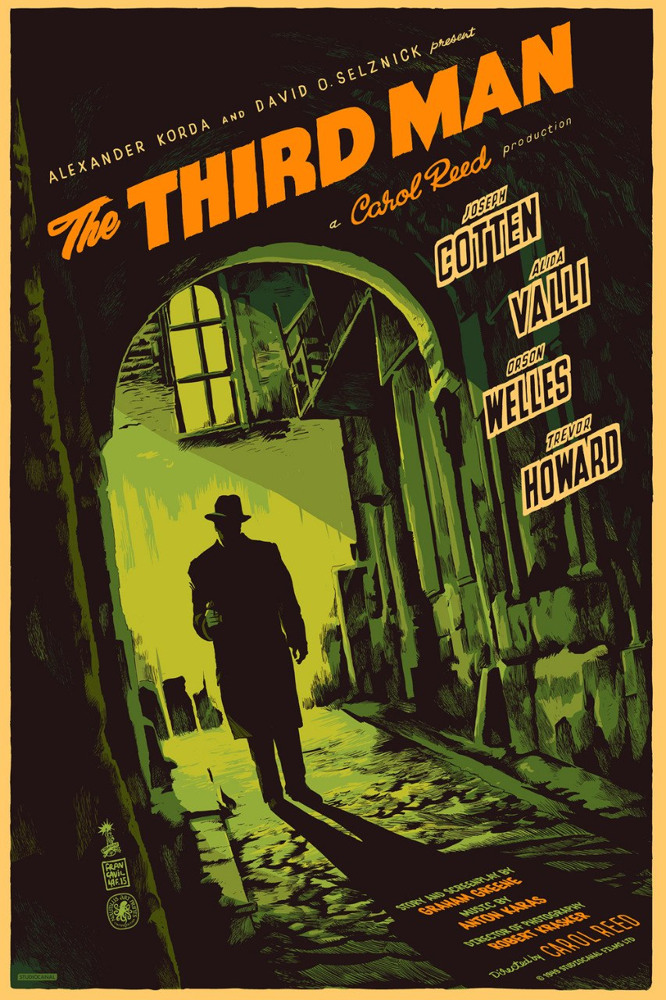

It’s a stone-cold classic.

Leeds Film Festival always has a stand of ‘retrospectives’ – older films they’re bringing back to the festival. In recent years I’ve tried to be a bit picky about which of these I go to, restricting myself to either things that are super rare and hard to see, or that are dramatically cinematic and cry out for the big screen.

It’s arguable that The Third Man falls into the latter camp, but only just. The 4K restoration looks nice, but still a little fuzzy round the edges, and there were a few moments when I questioned whether I was getting a better experience in the cinema than I would at home (compare against seeing 2001: A Space Odyssey on an enormous screen at the town hall. That was a huge difference from watching at home).

But this is quibbling. The film is great. The glasses of schnapps. The cigarettes. The heavy wooden coats. The stiff-upper-lip Brits. The chase sequences down bombed-out streets. The sewers.

An absolute joy to watch.

<!-- Screening: Vue in the Light, Screen 7. Festival listing: https://www.leedsfilm.com/whats-on/the-third-man-6z3b -->
