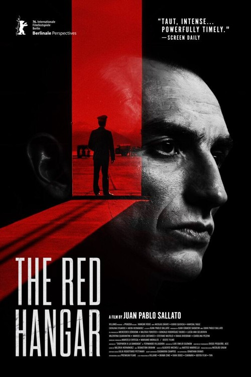
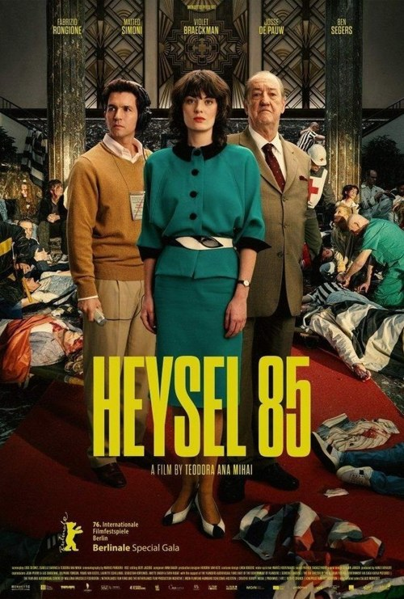

This year has a handful of fictionalised tellings of real events. They sit somewhere between documentaries and fiction: the people and the events are real, the dialogue and the details are imagined. The Red Hangar takes place on a Chilean air force base in the hours around the 1973 coup. Heysel 85 zooms in on the stadium disaster of a Liverpool–Juventus match in Belgium. It’s fair to say neither is a cheerful watch.

It’s not a (sub)genre I’ve much considered. There’s a faint aura of something distasteful – making entertainment from real-world tragedies – but it’s countered by a sense of warmth and humanity – putting humans and emotions back into stories that are told in timelines, statistics, diagrams.

This carries over into the visual language of the two. The Red Hangar is shot in glorious crisp black and white. Heysel 85 is fuzzy 16mm, designed to echo the homemade and news footage that gets spliced in, both in texture and in warm 80s colours. Both presentations give the films texture, and make clear that this is neither a dry documentary nor a modern Hollywood-style retelling.

I loved both. Despite being obviously, unavoidably, grim, they both managed to keep a sense of taut, breathless action, and flesh out the characters into real people.

<!-- Screening: Vue in the Light, Screen 12. Festival listing: https://www.leedsfilm.com/whats-on/the-red-hangar-fpwq -->
<!-- Screening: Vue in the Light, Screen 7. Festival listing: https://www.leedsfilm.com/whats-on/heysel-85-y5jl -->
