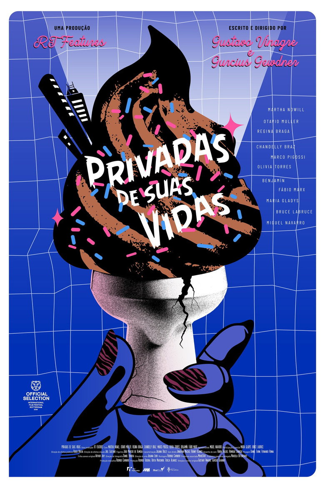

The curse of a film with a cracking title and a ridiculous concept (fill quote from blurb) is that it becomes very hard to live up to the expectations. For me, bowels of hell did t quite make it past this curse. It was a fun film. It was very silly. But the idea was probably still better than the execution.

There was a lot to enjoy - excruciating influencers, cashing in on their step child’s disability, a scat psychic (!), a cat eaten by a toilet, and waves and waves of shit. It leaned in hard to the gross and did a good job with it , proving once again how much more _fun_ physical effects are.

I overheard someone explaining their film festival choices. They’d picked Bowels of Hell, they said, because however good or bad it might be, it was unlikely to be boring. A sound argument. this might not have been great, but it was quite good fun.

<!-- Screening: Vue in the Light, Screen 11. Festival listing: https://www.leedsfilm.com/whats-on/bowels-of-hell-8dqs -->
