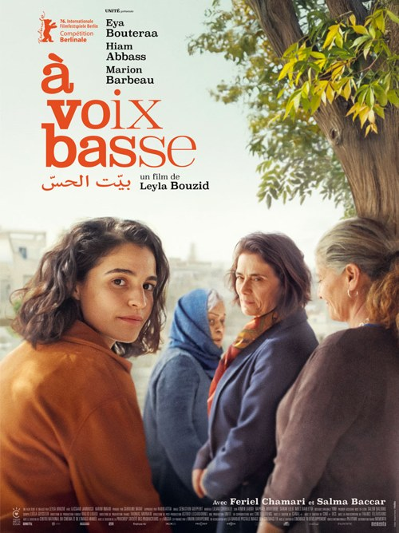

This was just so, so good. It’s the sort of film that for a good while I tended to shy away from as being too heavy, too glum, but it’s such a mistake. This is an excellent entry in the canon of Muslim-family-dramas-where-someone-is-gay. See also The Blue Caftan.

It’s a pretty familiar setup: we have a strong-willed, opinionated grandmother - loved, tolerated and resented in equal measures - we have long-suffering daughters, playing second fiddle to their brothers, never quite good enough to be accepted, and then we have the feisty, independent granddaughter - living in France, free from the shackles of Tunisia, seen with a mix of resentment and jealousy by those who remain.

It’s a funeral that brings them all together. 6 days of each other’s company, of probing the habits of their dead son/brother/uncle, of hushing up investigations for the sake of avoiding gossip. The tensions build and simmer. It’s a very well-paced film. Highly recommended!

<!-- Screening: Vue in the Light, Screen 7. Festival listing: https://www.leedsfilm.com/whats-on/in-a-whisper-sdy2 -->
