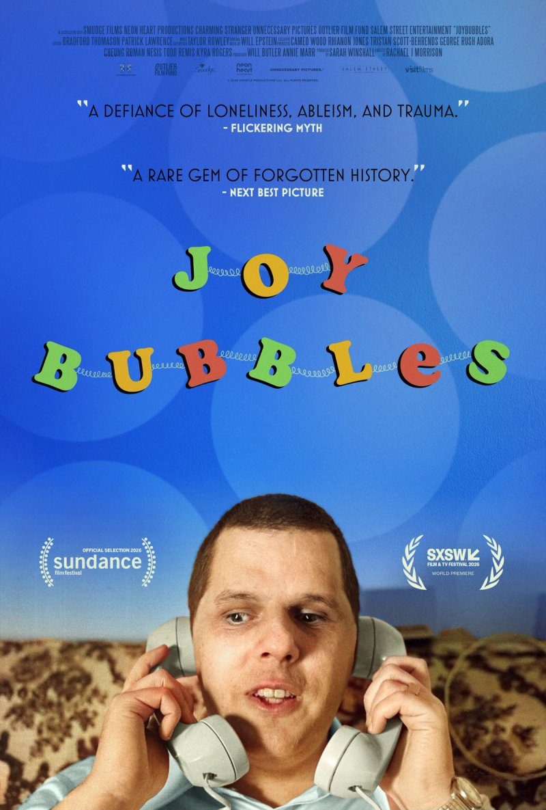

A decent documentary about the life of one of the original phone phreakers, phone hackers of the telephone age.

I’ll be honest—I found the hacking side a lot more interesting than the rest of it. The background to his life and all the parts up to his arrest for fraudulent long-distance calls was pretty fascinating. The later chunk about his answerphone message call line was a bit thin.

<!-- Screening: Everyman Cinema Screen 4. Festival listing: https://www.leedsfilm.com/whats-on/joybubbles-fmxq -->
