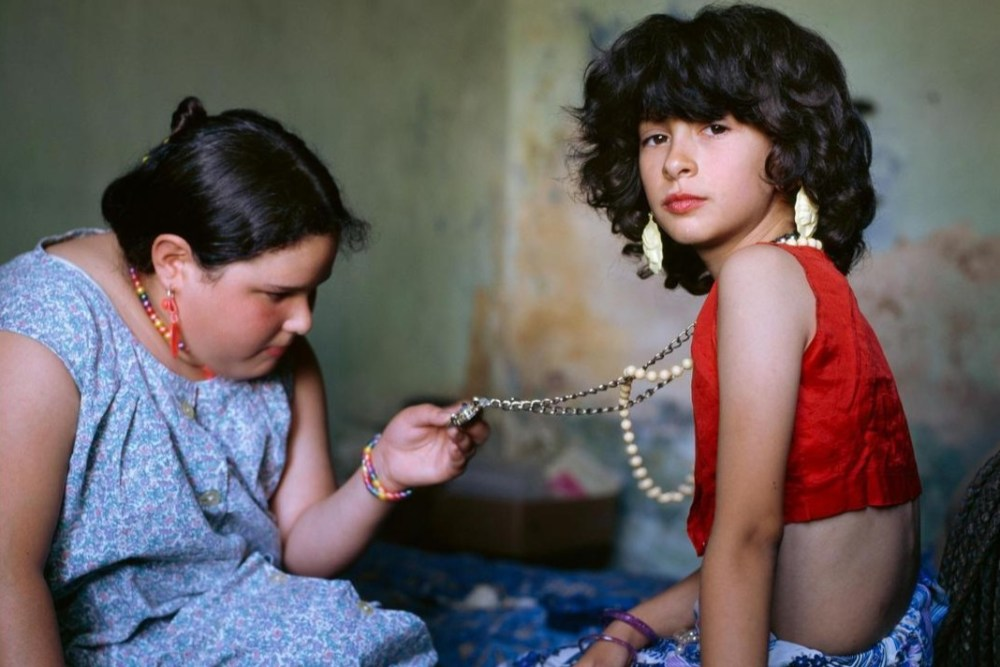

This follows a pair of cousins, the photographer- filmmakers neighbour, as they grow up over the course of 25 years. We’re in rural Argentina, surrounded by irrigation canals, poultry and cows. We see two small girls playacting their weddings and funerals (!), going swimming and trying on makeup. Year by year they change to teenagers and then to adults. Their relationship changes. Their self-confidence changes.

It’s hard to say if it’s sad. Or if it’s hopeful. It’s absolutely captivating watching them grow up and become different people but there’s a real sense of lost innocence. It’s hard not to wonder what the childhood versions of them would have made of their grown-up futures.

A very cool film project that I’m glad to have seen.

<!-- Screening: Everyman Cinema Screen 4. Festival listing: https://www.leedsfilm.com/whats-on/illusion-of-an-everlasting-summer-4ss3 -->
<!-- Still: Alessandra Sanguinetti, via https://variety.com/wp-content/uploads/2026/08/La-ilusion-de-un-verano-sin-fin-Copyright-Alessandra-Sanguinetti.jpg -->
