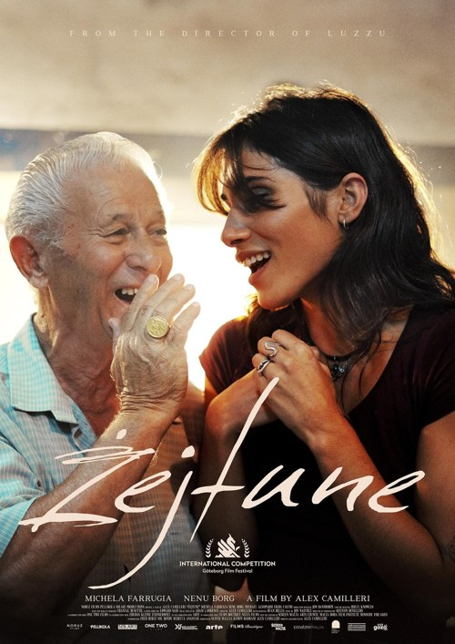
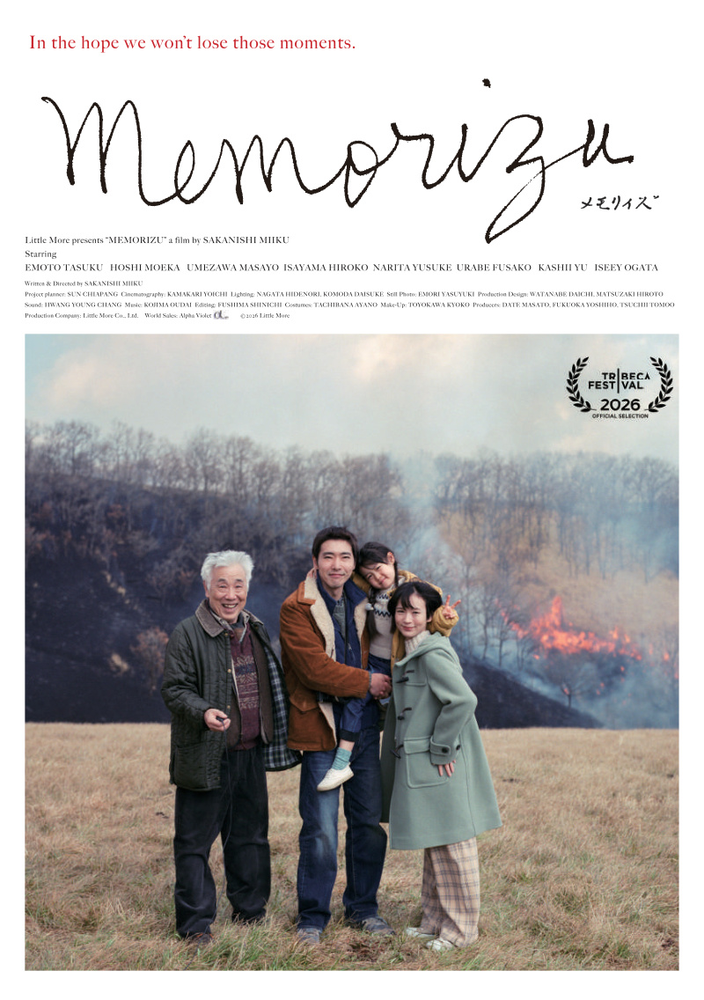

I’ve lumped these two together because they’re both showing in competition this year, but they are very different. Although perhaps have as many similarities as they do differences  

Both take us to an island. They shows us a generational gap being bridged. Both are deeply concerned with the old school - the analogue, the community, the heritage- crashing up against the modern - the impulsive, the independent. 

Zejtune follows x whose mother has recently died. Her remaining family are combative and cold, and it was clear she had some serious issues with her mother, but she’s been left 3 plots of land , maps scrawled with illegible Italian text that state her right to it. She enlists a wedding singer she meets, who turns out to be a legend of SINGING STYLE and sets off around the Island looking for her land.

The film isn’t really about that though. It’s about family and tradition, about historical wrongs and whether they can be righted (or at least forgiven), about land and place and people. There are links back to the fabulous In a Whisper, in the determination of the older characters that the youth should not flee the land. 

Memorizu cuts a much more slight figure. It’s a film in which almost nothing happens. Just life, moving along slowly. X sets off from his wife and young daughter to keep his step father company. He joins him in his old school photographic studio, driving him about for school portraits and wedding snaps. 

It’s a much more understated film but the new runs up against the old - iPhone footage contrasted against the warm film grain - the modern and cosmopolitan crashing up against the fusty and old but deeply community rooted ways of life. 

I loved both. 

I think both gave a beautiful slice of life in their respective cultures and took us with them on a journey that was small, personal but deeply satisfying.

<!-- Screening: Vue in the Light, Screen 12. Festival listing: https://www.leedsfilm.com/whats-on/zejtune-mjkx -->
<!-- Screening: Vue in the Light, Screen 12. Festival listing: https://www.leedsfilm.com/whats-on/memorizu-qw4t -->
