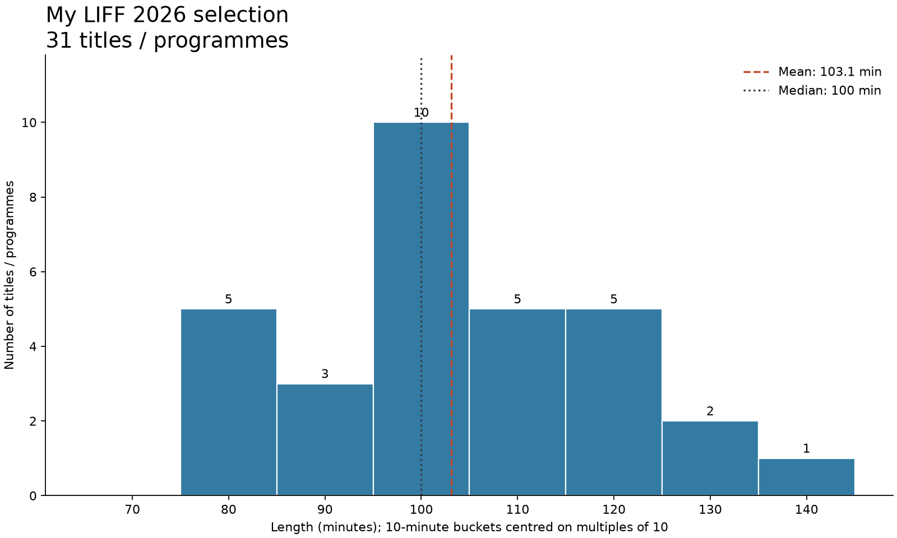
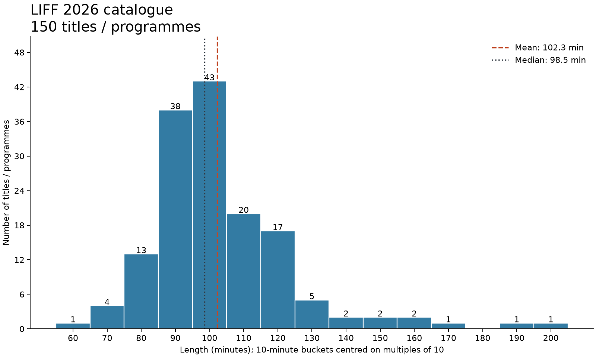
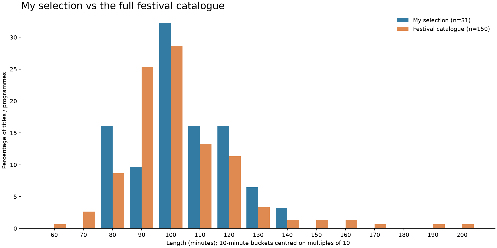

<!-- Working draft: running-time statistics collected on 5 November. Expand with more statistics and commentary later. Keep draft: true until ready to publish; set the publication date when making it non-draft. -->

A first look at the lengths of my 31 scheduled festival screenings, compared with the full catalogue of 150 films and programmes.

## Running times

| | My selection | Festival catalogue |
| --- | ---: | ---: |
| Films / programmes | 31 | 150 |
| Mean | 103.1 minutes | 102.3 minutes |
| Median | 100 minutes | 98.5 minutes |
| Shortest | 75 minutes | 64 minutes |
| Longest | 141 minutes | 196 minutes |
| Two hours or more | 6 (19.4%) | 21 (14.0%) |

My scheduled selection adds up to **53 hours and 17 minutes**. Five screenings are under 90 minutes, 20 are between 90 and 119 minutes, and six are at least two hours long.

The shortest in my selection is *Atlantic Rhapsody* at 75 minutes; the longest is *Minotaur* at 141 minutes (2 hours 21 minutes). Across the full catalogue, the extremes are the *Leeds Screendance Competition* programme at 64 minutes and *All of a Sudden* at 196 minutes (3 hours 16 minutes).

## My selection

The buckets are ten minutes wide, centred on multiples of ten. For example, the bucket centred on 90 covers 85 minutes up to, but excluding, 95 minutes; with whole-minute data, that means 85–94 minutes.

## The full catalogue

Each film or programme counts once, regardless of how many screenings it has. The saved catalogue contains 312 screenings of these 150 distinct entries.

## Comparing the two

This comparison uses percentages because the two groups are different sizes. My mean is only **0.9 minutes longer** than the festival mean, and my median is **1.5 minutes longer**.

The main differences in the distributions are:

- **75–84 minutes:** 16.1% of my selection, against 8.7% of the festival.
- **85–94 minutes:** 9.7%, against 25.3%.
- **95–104 minutes:** 32.3%, against 28.7%.
- **Two hours or more:** 19.4%, against 14.0%.

My selection has relatively fewer titles around 90 minutes and a slightly greater share of two-hour films, while avoiding the festival's very longest titles. The typical running time is nevertheless very similar.

### Counts and percentages by bucket

| Centre (minutes) | Whole-minute range | My selection | Festival catalogue |
| ---: | --- | ---: | ---: |
| 60 | 55–64 | 0 (0.0%) | 1 (0.7%) |
| 70 | 65–74 | 0 (0.0%) | 4 (2.7%) |
| 80 | 75–84 | 5 (16.1%) | 13 (8.7%) |
| 90 | 85–94 | 3 (9.7%) | 38 (25.3%) |
| 100 | 95–104 | 10 (32.3%) | 43 (28.7%) |
| 110 | 105–114 | 5 (16.1%) | 20 (13.3%) |
| 120 | 115–124 | 5 (16.1%) | 17 (11.3%) |
| 130 | 125–134 | 2 (6.5%) | 5 (3.3%) |
| 140 | 135–144 | 1 (3.2%) | 2 (1.3%) |
| 150 | 145–154 | 0 (0.0%) | 2 (1.3%) |
| 160 | 155–164 | 0 (0.0%) | 2 (1.3%) |
| 170 | 165–174 | 0 (0.0%) | 1 (0.7%) |
| 180 | 175–184 | 0 (0.0%) | 0 (0.0%) |
| 190 | 185–194 | 0 (0.0%) | 1 (0.7%) |
| 200 | 195–204 | 0 (0.0%) | 1 (0.7%) |

## The scheduled films

| Film / programme | Minutes |
| --- | ---: |
| Filipiñana | 100 |
| The Third Man | 104 |
| Daughters of the Forest | 95 |
| The Red Hangar | 83 |
| In a Whisper | 113 |
| Bowels of Hell | 111 |
| Joybubbles | 79 |
| Heysel 85 | 91 |
| São Paulo, Incorporated | 107 |
| Zejtune | 108 |
| Illusion of an Everlasting Summer | 94 |
| Light Pillar | 90 |
| Memorizu | 97 |
| World Animation Competition 1 | 99 |
| World Animation Competition 2 | 95 |
| The Apologist | 82 |
| Playtime | 124 |
| Minotaur | 141 |
| I Love Paris | 120 |
| Panelstory or Birth of a Community | 96 |
| Last Movies | 76 |
| Paper Tiger | 115 |
| A Long Winter | 117 |
| Sheep in the Box | 126 |
| Atlantic Rhapsody | 75 |
| Drifting Clouds | 95 |
| The Beirut Trilogy | 124 |
| Look Back | 100 |
| Furies | 133 |
| Rehearsals for a Revolution | 98 |
| I See Buildings Fall Like Lightning | 109 |

## Data and method

The selection is the 31 screenings in my planner's **Scheduled** set, including screenings still to come. Lengths are calculated from the saved start and end times. They are programme running times rather than a measurement of time spent at the cinema; introductions, Q&As and breaks are not added. Some shorts programme lengths are sums of the listed shorts and exclude breaks.

The festival comparison uses the [saved LIFF 2026 catalogue from 24 October](https://github.com/brokensbone/liff-utils/blob/70283e5156fab050ba4c93e1eedd3fe0387422b9/2026/clashfinder), extracted from the festival listings. This is a snapshot rather than a fresh catalogue scrape. Repeat screenings are deduplicated by listing URL. Shorts programmes, including the World Animation competitions, count as one entry each; *The Beirut Trilogy* also counts as one programme. Day of the Dead and Night of the Dead count through their constituent films, excluding the parent marathon listings to avoid double counting. Non-film social events, quizzes and workshops are excluded.

Four catalogue lengths are provisional estimates, included in the main figures:

- *Vera Media: Archiving the City*: 90 minutes.
- *Celebrating Louis le Prince*: 90 minutes.
- *Animation Panorama: Between Chaos and Vertigo*: 90 minutes.
- *LIFF SHORTS 2026: The Award-Winners*: 120 minutes.

Excluding those four leaves 146 entries, with a mean of **102.4 minutes** and a median of **99 minutes**. The comparison changes very little. None of those four is in my selection.

The [runtime review notes](https://github.com/brokensbone/liff-utils/blob/70283e5156fab050ba4c93e1eedd3fe0387422b9/2026/duration-review.json) distinguish summed shorts programmes from provisional estimates.

Data for later expansion: [my selection (CSV)](selection-lengths.csv) and [the full catalogue (CSV)](catalogue-lengths.csv). The catalogue CSV flags the four estimates. Percentages are rounded independently, so they may not add up to exactly 100%.
