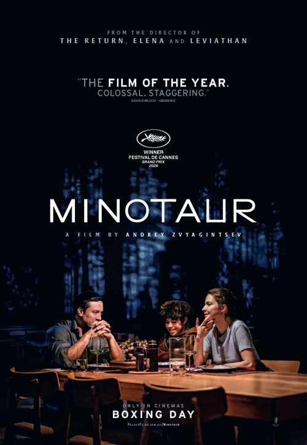

Underwhelming.

And I really can’t properly explain why without spoiling it.

It’s essentially a crime drama set in Russia, with the Ukraine war as a backdrop. The first half is all sprawling setup and suggests a much more interesting film than we eventually get. An awful lot of what you assume is going to be important to the plot is really just window dressing on a pretty small story. There are some memorable scenes, but it never really came together into a good film.

<!-- Screening: Cottage Road Cinema. Festival listing: https://www.leedsfilm.com/whats-on/minotaur-qxkt -->
<!-- Poster: https://www.palacefilms.com.au/minotaur -->
