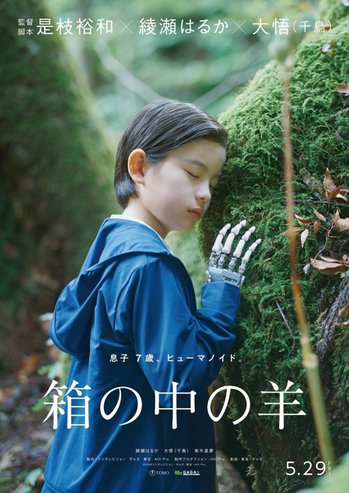
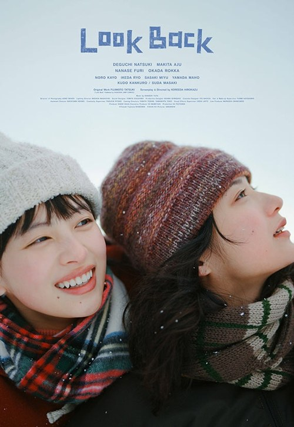

## Sheep in the Box

<!-- Review to follow. Screening 24: 10 November, 20:15, Vue in the Light, Screen 7. Festival listing: https://www.leedsfilm.com/whats-on/sheep-in-the-box-qvpt. Poster: https://www.impawards.com/intl/japan/2026/hako_no_naka_no_hitsuji.html -->

## Look Back

<!-- Review to follow. Screening 28: 13 November, 20:45, Vue in the Light, Screen 7. Festival listing: https://www.leedsfilm.com/whats-on/look-back-542n. Poster: https://www.palacefilms.com.au/look-back -->
